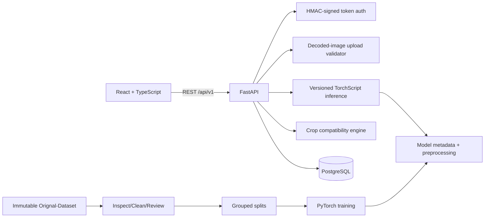

# Architecture

The raw dataset is read-only. Inspection artifacts, cleaning manifests, visual review sheets, splits, reports, checkpoints, and exports are derived outside it. No image-to-property regression endpoint exists: properties are stored only with a declared laboratory, sensor, or user-provided source.

The split layer assigns each duplicate/near-duplicate `group_id` to one partition only. `train.py` reads train and validation CSVs only; `evaluate.py` reads the test CSV only after selection. Inference loads the model metadata and TorchScript artifact as a pair, preventing preprocessing/class-order mismatch.

Weather and location are protocol boundaries (`WeatherService`, `LocationService`) rather than hard-coded providers. When data is unavailable, recommendations say so rather than creating synthetic weather.
